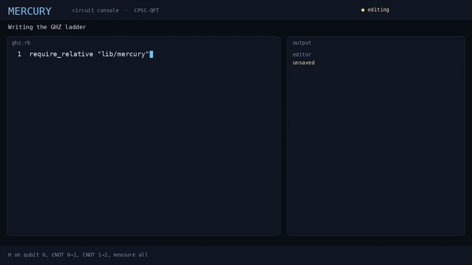

<!--
Copyright (c) 2026 Ahmad Ali Parr and others.
SPDX-License-Identifier: LicenseRef-CPSC-ESCL-1.0 OR AGPL-3.0-only
This file is dual-licensed under the CPSC Eclipse Strict Copyleft License v1.0
or the GNU AGPL v3 only. Both are strict copyleft.
-->

# CPSC — Conservation-Preserving Scattering Compiler

**Repository:** [github.com/AHMADALIPARR/cpsc-qft](https://github.com/AHMADALIPARR/cpsc-qft)

Proof-carrying lattice scattering for 1+1D scalar field theory. Conservation laws are compilation constraints, not post-selection filters.

<p align="center">
  <a href="docs/mercury-circuit-demo.mp4">
    
  </a>
  <br>
  <a href="docs/mercury-circuit-demo.mp4"><strong>Mercury circuit demo (MP4)</strong></a>
  · GHZ ladder written, rejected, replaced by an admitted ZZ ring
</p>

**Status:** Operator commutation is closed and sorry-free. Every schedule the analyzer admits, Trotterized for any number of steps, commutes as an operator on \((R^2)^{\otimes N}\) with the conserved operator of its mode (\(\sum Z\) at \(\lambda = 0\), \(\prod X\) for \(\lambda \neq 0\)). The proof lives in `lean/CPSC/Operator.lean` and uses no project axioms. Additional sorry-free results establish magnetization-sector invariance for admitted Ising schedules (`lean/CPSC/LeakageBound.lean`) and the skew-Hermitian property of the generator (`lean/CPSC/MathlibInstantiation.lean`). Circuit axioms in `lean/CPSC/CircuitAxioms.lean` connect these theorems to the Q# emission path. The Python analyzer, orbit check, Trotter product, digest binding, and Q# backend all run. Paper: [paper/PAPER.md](paper/PAPER.md).

---

## Overview

The Conservation-Preserving Scattering Compiler (CPSC) is a research prototype that inverts the usual workflow of near-term quantum simulation of lattice field theories. Instead of evolving a Trotterized circuit and then discarding shots whose measured quantum numbers disagree with the input, CPSC refuses, at compile time, any gate that would leave the joint symmetry manifold of the Hamiltonian. Every admitted schedule carries a machine-checked certificate that the emitted unitary commutes with the conserved operators of the chosen mode.

The working model is a periodic qubit lattice that stands in for the Ising limit of 1+1D \(\phi^4\) theory:

\[
H = -J \sum_{i=0}^{N-1} Z_i Z_{i+1} + \lambda \sum_{i=0}^{N-1} X_i.
\]

Energy conservation is automatic for any time-independent Hamiltonian. The non-trivial compilation constraints are the symmetries of \(H\): magnetization \(\sum Z\) when \(\lambda = 0\), and the global spin-flip \(\prod X\) when \(\lambda \neq 0\). Lattice momentum is specified and partially enforced by a classical orbit-closure check; full block synthesis remains future work.

The compiler is deliberately narrow. It does not claim a new symmetry, nor does it claim to solve continuum \(\phi^4\). Its architectural bet is that the allowed scattering channel of a lattice QFT can be treated as the synthesis domain, and that the proof of channel membership can travel with the circuit.

## Motivation

Near-term quantum devices are noisy. When a scattering experiment is performed by Trotterizing a lattice Hamiltonian and sampling the final state, a non-negligible fraction of shots land outside the symmetry sector of the initial state. The conventional response is post-selection: measure the relevant quantum numbers and discard the disagreeing shots. Post-selection is a filter, not a compiler. It wastes shots, it does not prevent the hardware from exploring the wrong subspace, and it provides no formal guarantee that the retained shots correspond to a unitary that actually preserved the symmetry.

CPSC inverts the relationship. The analyzer examines every gate before it is emitted. A gate that changes the active conserved quantity is rejected with a precise reason. Only schedules that remain inside the symmetry manifold are allowed to proceed. Because the rejection is performed on the gate list itself, the certificate that accompanies an admitted schedule is a theorem, not a statistical claim. The Lean development proves that every admitted Trotter product, of any length, commutes with the mode invariant on the full Hilbert space \((R^2)^{\otimes N}\) for an arbitrary commutative ring \(R\).

This design has two immediate consequences. First, the number of shots that must be discarded for symmetry reasons is reduced to the residual leakage caused by hardware noise; the ideal compiled unitary has zero inter-sector amplitude. Second, an edited or rewritten circuit can be re-checked: if a hardware pass inserts a forbidden gate, the certificate fails closed.

## The mathematical model

The Hamiltonian above is the transverse-field Ising model on a ring. The quartic term that would appear in a \(\phi^4\) interaction is identically proportional to the identity on qubits, because \(X^2 = I\). It is recorded in `src/cpsc/hamiltonian.py` and then dropped. A faithful lattice \(\phi^4\) requires a truncated real field (or higher spin) per site; a numerical sketch of the truncated oscillator appears in `rust/src/phi4_encoding.rs`.

Two compilation modes are distinguished by the value of the transverse field:

| Mode | \(\lambda\) | Conserved operator | Forbidden gates |
| --- | --- | --- | --- |
| Ising | \(= 0\) | \(\sum_i Z_i\) (magnetization) | single \(X\), parity-even \(X\) pair |
| Spin-flip | \(\neq 0\) | \(\prod_i X_i\) | lone \(Z\) |

In Ising mode the Hamiltonian is diagonal in the computational basis. Magnetization is conserved exactly. A transverse rotation with nonzero angle moves the magnetization eigenvalue by \(\pm 2\) and is rejected. An even pair of transverse rotations also changes magnetization in general (by \(0, \pm 2,\) or \(\pm 4\)) and is likewise rejected; this aligns the Python analyzer with the Lean predicate `preservesMagnetization`.

In spin-flip mode the transverse field is present. The global operator \(\prod X\) commutes with every term in \(H\). A lone \(Z\) anticommutes with it and is rejected. Single \(X\) gates and even pairs are admitted.

Lattice momentum, generated by the cyclic shift, is enforced classically by requiring that every local term appear together with all of its translates. Full synthesis of momentum eigenspaces is listed as an open problem.

Energy is not an independent constraint. Because \(H\) is time-independent, \([H, H] = 0\), so the exact evolution \(e^{-iHt}\) conserves energy automatically.

## How the compiler works

The compilation pipeline has four stages.

1. **Symmetry analysis.** The analyzer receives a list of gates and the value of \(\lambda\). It classifies each gate by kind (`magnetization`, `phase`, `transverse`, `parity_even`, `illegal`) and rejects any gate that fails the active invariant. The rejection is total: a single forbidden gate aborts the compilation.

2. **Orbit closure.** If translation invariance is required, the compiler checks that the support of every admitted gate is closed under the cyclic shift. A lone bond or a single transverse flip is rejected; the full ring or the full transverse field is accepted.

3. **Trotterization and emission.** Only the admitted local terms are exponentiated. The Python path produces a state-vector evolution for small \(N\) (the demo is limited to \(N \le 8\)). The Q# path emits the corresponding operations (`IsingEvolution`, `SpinFlipEvolution`) together with the lemmas that interpret the gate list.

4. **Certificate binding.** A cryptographic digest of the admitted gate list is computed and bound to a Lean theorem. The theorem states that the Trotter product of any length of that exact list commutes with the mode invariant. Editing a single gate changes the digest; the certificate no longer matches.

The Python entry point is `cpsc.compiler.compile_scattering`. The Lean development is independent of the concrete angles: the commutation holds for every choice of rotation parameters.

## Formal verification

The core result is proved in Lean 4 without project axioms:

```lean
theorem admitted_trotter_commutes (mode : CPSC.Mode) (ι : R) (ang : Angles R)
    (gs : List CPSC.GateKind) (h : CPSC.admitted mode gs = true) (steps : Nat) :
    Commutes (trotterOp (n := n) ι ang gs steps) (invariant mode)
```

The proof proceeds by showing that every gate admitted by the Boolean predicates `preservesMagnetization` and `preservesSpinFlip` commutes with the corresponding operator (`Mag` or `PiX`), then lifting the property through composition and Trotter repetition. The operator model is defined on functions from computational-basis strings to a commutative ring \(R\); when \(R = \mathbb{C}\) this is exactly the usual Hilbert space. Pauli operators act by multiplication by signs or by bit flips. Each gate is the elementary rotation \(c\cdot I + \iota s\cdot P\) for its Pauli generator \(P\). Because \(P^2 = I\), these rotations coincide with the matrix exponentials used by the Python and Q# backends for any angle.

Rejection is not vacuous. When \(2\iota s \neq 0\) (i.e., \(\sin\theta \neq 0\) over \(\mathbb{C}\)), a transverse rotation fails to commute with magnetization and a lone \(Z\) fails to commute with \(\prod X\). Both facts are proved as operators, not merely as Boolean predicates.

Additional sorry-free results include:

- `ising_preserves_magnetization` in `LeakageBound.lean`: an admitted Ising schedule preserves every magnetization sector. Ideal evolution therefore never leaves the sector; any observed leakage is due to noise.
- `generator_skew_Hermitian` in `MathlibInstantiation.lean`: the generator \(-itH\) is skew-Hermitian when \(H\) is Hermitian.

Circuit axioms in `CircuitAxioms.lean` declare that the Q# operations `IsingEvolution` and `SpinFlipEvolution` realize the corresponding Trotter products and therefore inherit the proved commutation properties. These axioms are the formal interface between the Lean development and the executable circuits.

An axiom audit (`lean/Audit.lean`) confirms that the development uses only the standard Lean axioms (`Quot.sound`, `Classical.choice`, `propext`).

## Implementation

The repository is organized as a multi-language research prototype.

- **Python** (`src/cpsc/`). The analyzer, the compiler, the certificate binder, and a small state-vector demo. Dependencies are limited to NumPy. The package is installed in editable mode via `pyproject.toml`.
- **Lean** (`lean/`). The formal development. `Operator.lean` contains the main commutation theorems. Supporting files define the Boolean certificate layer, the emitted-sample certificate, the circuit axioms, and the leakage and instantiation sketches. The toolchain is Lean 4.22.0.
- **Q#** (`qsharp/`). Operations that emit the Ising and spin-flip Trotter steps, together with the lemmas that the Python compiler and the Lean development share. The Q# code fails closed on a rejected factor.
- **Frontend** (`frontend/`). A Ruby-based circuit DSL and state-vector simulator (Mercury) that drives the interactive console served from `docs/qsim.html`.
- **Rust sketches** (`rust/`). Numerical evaluation of the sector-leakage bound and a truncated-oscillator constructor for a non-trivial \(\phi^4\) interaction.
- **Documentation and paper** (`docs/`, `paper/`). The mathematical specification, the channel-pruning rules, the open-problems list, and the LaTeX paper.

A GitHub Pages site serves the static console. Rebuild the frontend bundle with `frontend/web/build.sh`.

## Getting started

```bash
python -m venv .venv && source .venv/bin/activate
pip install -e ".[dev]"
pytest -q
python -m cpsc.demo
```

Python 3.11 or newer is required. No quantum hardware or simulator beyond the included state-vector code is needed. The demo prints the mode, the residual leakage (which is zero for the ideal evolution), the certificate digest, and the rejection messages for adversarial edits.

To check the Lean development:

```bash
cd lean
lake build
```

## Project layout

```
docs/SPECIFICATION.md          mathematical construction and PCSS workflow
docs/CHANNEL_PRUNING.md        channel rules and what they do not mean
docs/OPEN_PROBLEMS.md          remaining obligations
lean/CPSC/Operator.lean        closed operator commutation proof (sorry-free)
lean/CPSC/LeakageBound.lean    magnetization-sector invariance (sorry-free)
lean/CPSC/MathlibInstantiation.lean  skew-Hermitian generator (sorry-free)
lean/CPSC/CircuitAxioms.lean   axioms linking proved theorems to Q# circuits
lean/CPSC/Lemmas.lean          bridge theorems
lean/Audit.lean                axiom audit
lean/CPSC/Emitted.lean         sample certificate carrying emitted_commutes
qsharp/                        Ising and spin-flip Trotter operations
src/cpsc/                      analyzer, compiler, certificate binder
rust/                          numerical leakage bound and φ⁴ truncation sketches
ontologies/                    illustrative Planck-temperature ontology
tests/                         adversarial rejection, orbit check, digest binding
paper/PAPER.md                 paper landing page
paper/OPERATOR_PROOFS.md       mathematical write-up of the Lean theorems
```

## Certificate story

The analyzer admits a schedule or rejects it. For every admitted schedule the Lean development proves the operator identity: the Trotter product of any length commutes with the mode invariant. See `lean/CPSC/Operator.lean` (`admitted_trotter_commutes`) and `lean/Audit.lean`. Rejection is not vacuous: with a nonzero rotation a transverse flip moves magnetization and a lone \(Z\) breaks \(\prod X\). Emitted certificates carry the corresponding theorem (`emitted_commutes`). The circuit axioms make the link to the Q# operations explicit.

A concrete example appears in `lean/CPSC/Emitted.lean`: a four-site Ising ring is admitted by `rfl`, and the operator theorem is obtained by instantiating the main result.

## Relation to existing methods

Block-diagonalization by a conserved charge is textbook. Symmetry-protected codes, subspace-preserving compilations in Qiskit and PennyLane, and verified quantum-circuit stacks (VOQC, SQIR, CertiQ-style developments) already exist. Post-selection on symmetry bits is the method this repository refuses to call a compiler. The narrower claim is that the allowed scattering channel of a lattice QFT can be treated as the synthesis domain and that the channel-membership proof can be shipped with the circuit. See `docs/OPEN_PROBLEMS.md` before citing novelty.

## Limitations and open problems

The prototype is an Ising-limit shadow of \(\phi^4\), not continuum \(\phi^4\). Momentum is enforced only by orbit closure, not by full eigenspace synthesis. Hardware noise is unmodeled; the ideal leakage is zero, but device leakage is not bounded inside the formal development. The continuous-time Lindblad expansion and the operator-norm form of the leakage coefficient remain open. The truncated-oscillator encoding of a genuine \(\phi^4\) interaction is present only as a numerical sketch. Full unitarity of the matrix exponential over \(\mathbb{C}\) requires the corresponding Mathlib lemma. A continuous-integration workflow for the Lean build is present on a feature branch but not yet on `main`.

These limitations are recorded honestly in `docs/OPEN_PROBLEMS.md`. The discharged obligations—Boolean admission, digest binding, mode switching, operator commutation, and the algebraic link from admitted schedules to sector invariance—are proved.

## License

Dual strict copyleft. You may use this repository under either:

- the CPSC Eclipse Strict Copyleft License, Version 1.0 (`LicenseRef-CPSC-ESCL-1.0`), or
- the GNU Affero General Public License, Version 3 only (`AGPL-3.0-only`).

Both options are strict copyleft, including network use. This is not the Eclipse Public License, and it is not Apache-2.0. There is no classpath exception and no permissive relicensing. Headers on each source file are part of the notice. See [LICENSE](LICENSE), [NOTICE](NOTICE), and [LICENSES/](LICENSES/).

## Citation

See [CITATION.cff](CITATION.cff).

---

The interactive console is available at [ahmadaliparr.github.io/cpsc-qft/qsim.html](https://ahmadaliparr.github.io/cpsc-qft/qsim.html).
